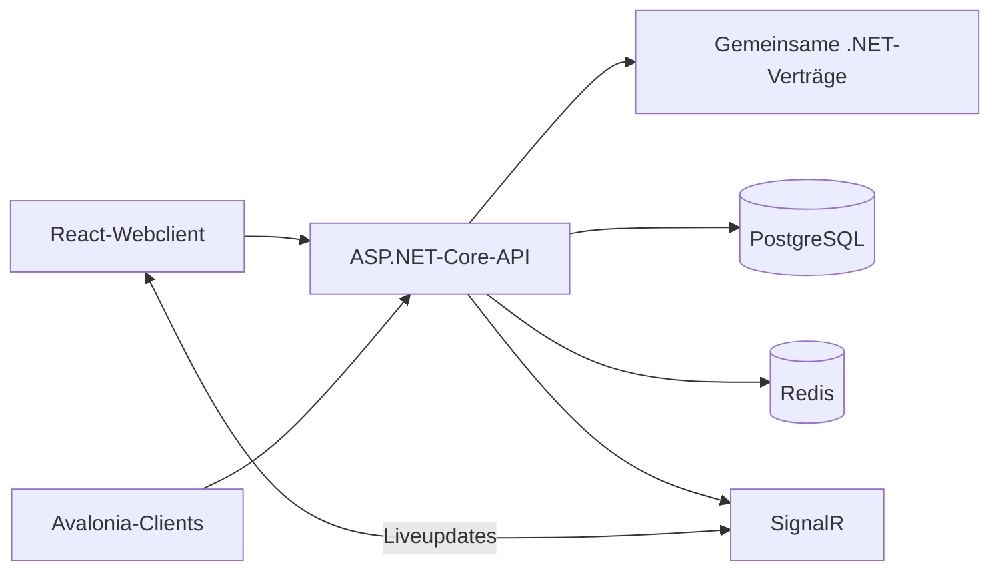

# Feuerwehr-KPP Dokumentation

Feuerwehr-KPP ist eine Anwendung für Feuerwehr-Verwaltungs- und Einsatzabläufe. Dieses Handbuch führt durch die vorhandenen Web- und Avalonia-Clients, den Entwicklungsstart und die technische Architektur.

Die Dokumentation unterscheidet zwischen Funktionen, die im Repository implementiert sind, und Anforderungen oder Plattformarbeiten, die noch geprüft werden müssen. Die Screenshots zeigen den Avalonia-Login und die Hydrantenkarte; sie sind keine Abbildung der separaten Einsatz-Lagekarte.

## Einstieg

- [Projektüberblick und Entwicklungsstart](getting-started.md)
- [Webanwendung](web-application.md)
- [Avalonia-Client und Screenshots](screenshots.md)
- [Authentifizierung](AUTHENTICATION.md) und [Kurzübersicht](AUTH_QUICK_REFERENCE.md)
- [Architektur](architecture.md)
- [OpenAPI für GitBook erzeugen](api/openapi.md)
- [Lagekarte und Einsatztagebuch](incident-modules.md)

## Architekturentscheidungen

Die akzeptierten ADRs sind Teil der technischen Dokumentation. Sie erläutern, warum das Projekt als Monorepository organisiert ist und warum Avalonia für die plattformübergreifenden Clients gewählt wurde:

- [ADR-0001: Use a Monorepository](adr/0001-use-monorepo.md)
- [ADR-0002: Use Avalonia UI for Cross-Platform User Interfaces](adr/0002-use-avalonia-for-cross-platform-clients.md)

## Projekt auf einen Blick

Diese Übersicht beschreibt den aktuellen Codeaufbau. Plattformunterstützung allein bedeutet nicht, dass jede Funktion auf jedem Client gleich weit umgesetzt oder für den Produktionseinsatz freigegeben ist.
