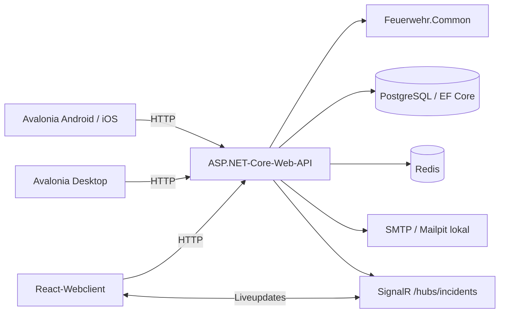
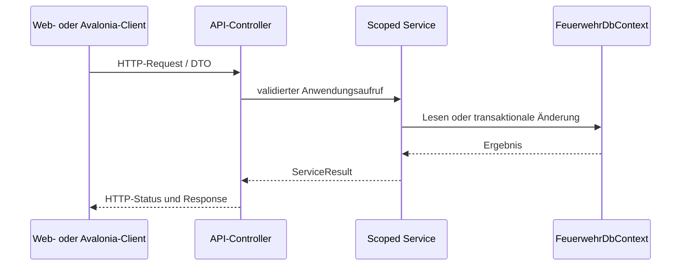

# Systemarchitektur

## Laufzeitübersicht

Der Aspire-AppHost startet und verbindet die Entwicklungsressourcen. Er verwendet PostgreSQL, Redis und lokal Mailpit; das Frontend wird als Vite-Ressource orchestriert. Ein Produktionsbetrieb muss Verbindungen, Secrets, E-Mail, Proxy und erlaubte Web-Origins passend konfigurieren.

## Schichten und Verantwortlichkeiten

### Verträge

`src/Feuerwehr.Common/Models/` enthält gemeinsam genutzte Requests, Responses, DTOs und Enums. Datenbank-Entities und UI-spezifische ViewModels gehören nicht in dieses Projekt.

### Backend

Der typische Ablauf ist:

Controller kümmern sich um Routing, HTTP-Validierung, Autorisierungsattribute und das Mapping von `ServiceResult`. Fachlogik und Datenzugriff liegen in scoped Services. Die EF-Core-Konfiguration und Migrationen liegen im Serverprojekt.

### Clients

- Der Webclient verwendet React/TypeScript und spricht zur Laufzeit über HTTP und SignalR mit der API.
- Avalonia teilt Views, ViewModels und Client-Services zwischen Plattformprojekten, soweit dies sinnvoll ist.
- Das Common-Projekt ist keine automatische Quelle für TypeScript-Verträge; die Frontend-DTOs werden nicht automatisch aus C# generiert.
- Die Entscheidung für Avalonia und die Grenzen plattformspezifischer Implementierungen stehen in [ADR-0002](adr/0002-use-avalonia-for-cross-platform-clients.md).

## Einsatzmodule

Lagekarte und Einsatztagebuch verwenden denselben Einsatzdatensatz, aber getrennte Rollen. Schreibbefehle nutzen Command-IDs zur Idempotenz und erwartete Versionen zur Konflikterkennung. Lagekartenänderungen können an eine Bearbeitungssperre gebunden sein. Auditdaten und Outbox-Nachrichten werden zusammen mit Fachänderungen persistiert; ein Hintergrunddienst verteilt Liveupdates über SignalR.

Abgeschlossene Einsätze sind für weitere Änderungen gesperrt. Die Lagekarte und das Tagebuch haben getrennte Viewer- und Editor-Rollen; Administratorstatus allein verleiht keinen allgemeinen Lesezugriff auf deren Inhalte. Weitere Details und bekannte Abnahmepunkte stehen in [Lagekarte und Einsatztagebuch](incident-modules.md).

## Identität und Zugriff

Das Backend verwendet ASP.NET Core Identity und JWT-Bearer-Authentifizierung. Rollen und Policies werden serverseitig durchgesetzt. Der SignalR-Hub akzeptiert JWT-Tokens für Verbindungen über den dokumentierten `access_token`-Queryparameter. Siehe [Authentifizierung](AUTHENTICATION.md) für Seed-Voraussetzungen, Tokenablauf und Rollen.

## Start und Betrieb

Beim API-Start werden Migrationen und Seed-Daten ausgeführt. Health-Endpunkte und OpenAPI/Scalar sind in der Development-Umgebung verfügbar; Prometheus-Metriken werden unter `/metrics` gemappt. SMTP, Datenbank, Cache, JWT-Schlüssel, Frontend-Basis-URL und CORS müssen für die konkrete Betriebsumgebung konfiguriert werden.

Für OpenAPI-Generierung und GitBook-Import siehe [OpenAPI für GitBook erzeugen](api/openapi.md).
