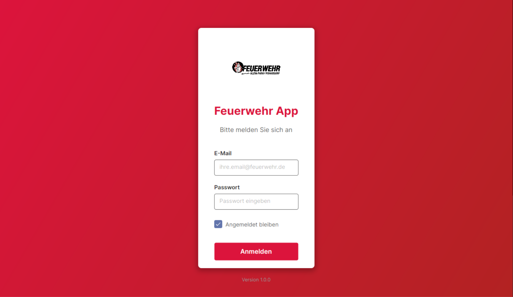
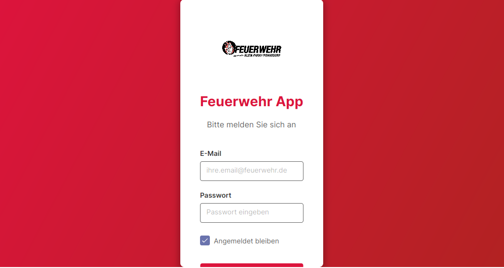
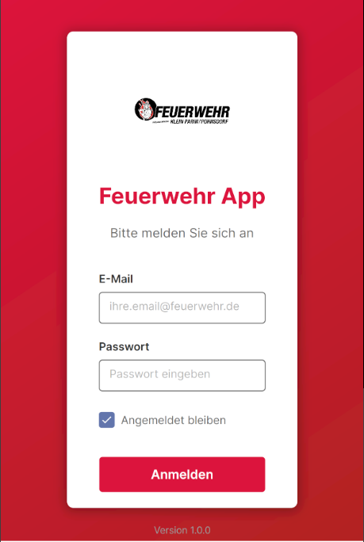
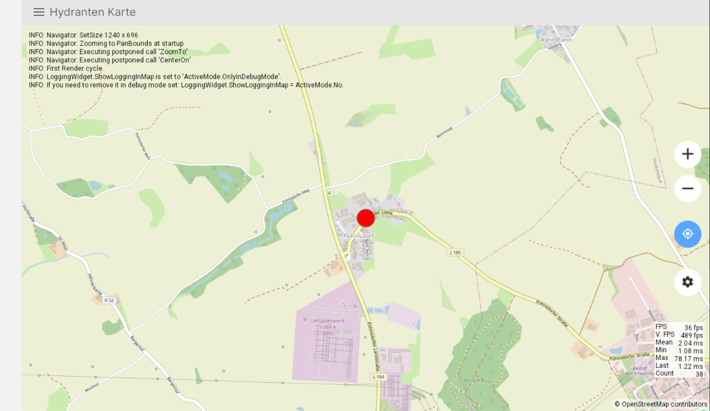
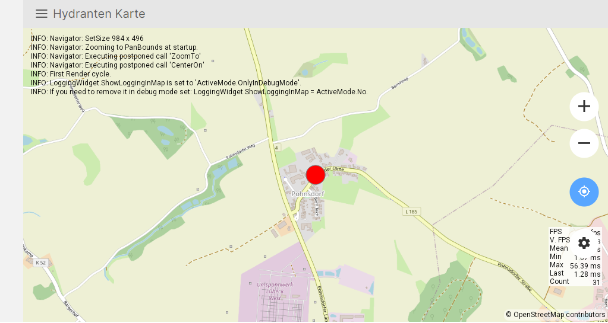
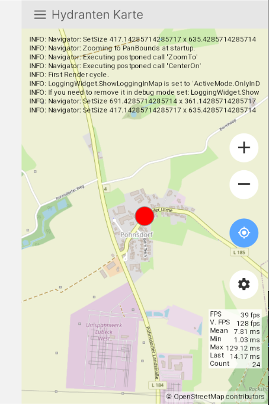

# Avalonia-Client und Screenshots

Die folgenden Aufnahmen stammen aus dem Repository und zeigen die Avalonia-Oberfläche in unterschiedlichen Tablet- und Hochformatauflösungen. Die Labels in den Screenshots sind deutsch.

## Anmeldung

Die Login-Ansicht zeigt E-Mail, Passwort, eine Option „Angemeldet bleiben“ und die Schaltfläche „Anmelden“.

## Hydrantenkarte

Die Kartenansicht ist mit „Hydranten Karte“ beschriftet. Die Aufnahmen zeigen die OpenStreetMap-Grundkarte, Kartensteuerungen und einen markierten Standort. Sie belegen nicht, dass die abgebildeten Hydranteninformationen vollständig oder aktuell sind.

Die bereitgestellten Kartenaufnahmen enthalten Diagnose- und Leistungsanzeigen aus der Entwicklungsumgebung. Diese Anzeigen sind Teil der Aufnahmen und keine Aussage über die Produktionsoberfläche. Die Kartenansicht weist OpenStreetMap als Quelle aus; eine Weiterverwendung der Kartendaten unterliegt den [OpenStreetMap-Attributionshinweisen](https://www.openstreetmap.org/copyright).

## Abgrenzung

Die Screenshots zeigen die Hydrantenkarte des Avalonia-Clients. Die webbasierte [Einsatz-Lagekarte](incident-modules.md) ist eine eigene Funktion und wird in diesen Bildern nicht gezeigt.
